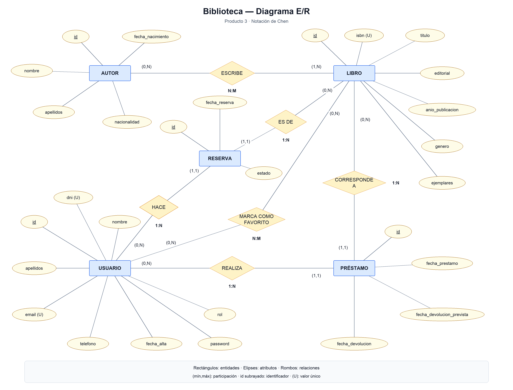
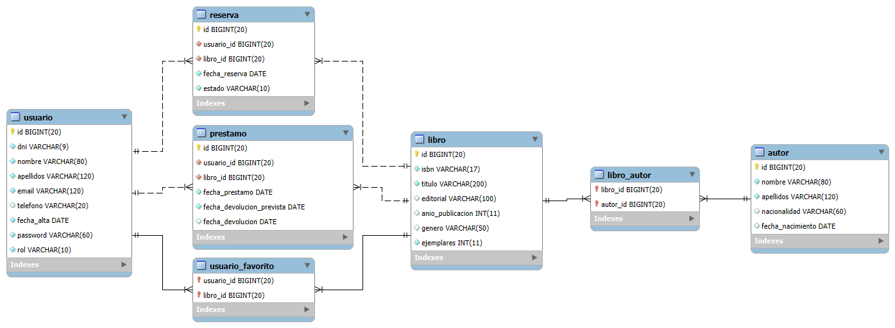

# Modelo de datos

Este documento es la referencia técnica del modelo: los dos diagramas de la entrega y las reglas que siguen la base
de datos y las entidades JPA.

## Diagrama E/R

El diagrama utiliza notación de Chen. Junto a cada entidad, el par (mín,máx) indica su participación mínima y máxima
en la relación; la clave primaria va subrayada y (U) marca los valores únicos.

El Producto 3 conserva `Autor`, `Libro`, `Usuario` y `Préstamo`, e incorpora la entidad `Reserva` y la relación
**marca como favorito** entre Usuario y Libro:

- **Usuario** añade `password` (hash BCrypt) y `rol` (`ADMIN` o `USER`) a sus atributos anteriores.
- **Reserva** tiene identificador propio, fecha de reserva y estado (`ACTIVA` o `CANCELADA`). Cada reserva corresponde
  exactamente a un usuario y a un libro. Un usuario o un libro pueden no tener reservas o tener varias.
- **Favoritos** es una relación N:M sin atributos propios: un usuario puede marcar varios libros y un libro puede ser
  favorito de varios usuarios. La participación mínima de ambos es cero. En Chen se representa como una relación,
  no como una nueva entidad de dominio.

Así, el E/R tiene **cinco entidades**, mientras que el modelo relacional tiene **siete tablas**, incluidas las dos
intermedias `libro_autor` y `usuario_favorito`.

## Relaciones

Los pares de participación se indican junto a cada entidad, como en el diagrama de Chen.

| Relación | Cardinalidad y participación | En la base de datos | En JPA |
|---|---|---|---|
| Autor **escribe** Libro | N:M; Autor (0,N), Libro (1,N) | Tabla intermedia `libro_autor` | `Libro.autores` `@ManyToMany` + `@JoinTable` (lado propietario) · `Autor.libros` `@ManyToMany(mappedBy)` |
| Usuario **realiza** Préstamo | 1:N; Usuario (0,N), Préstamo (1,1) | `prestamo.usuario_id` | `Prestamo.usuario` `@ManyToOne` · `Usuario.prestamos` `@OneToMany(mappedBy)` |
| Préstamo **corresponde a** Libro | 1:N desde Libro; Préstamo (1,1), Libro (0,N) | `prestamo.libro_id` | `Prestamo.libro` `@ManyToOne` · `Libro.prestamos` `@OneToMany(mappedBy)` |
| Usuario **hace** Reserva | 1:N; Usuario (0,N), Reserva (1,1) | `reserva.usuario_id` | `Reserva.usuario` `@ManyToOne` · `Usuario.reservas` `@OneToMany(mappedBy)` |
| Reserva **es de** Libro | 1:N desde Libro; Reserva (1,1), Libro (0,N) | `reserva.libro_id` | `Reserva.libro` `@ManyToOne` · `Libro.reservas` `@OneToMany(mappedBy)` |
| Usuario **marca como favorito** Libro | N:M; Usuario (0,N), Libro (0,N) | Tabla intermedia `usuario_favorito` | `Usuario.favoritos` `@ManyToMany` + `@JoinTable` (lado propietario) · `Libro.marcadoPor` `@ManyToMany(mappedBy)` |

Visto desde el E/R, **Usuario–Libro también es N:M a través de los préstamos**: un usuario toma prestados muchos libros
y un libro lo toman prestado muchos usuarios a lo largo del tiempo. Como esa relación tiene atributos propios
(las fechas), se convierte en la entidad `Prestamo`. `Reserva` también relaciona Usuario y Libro con atributos propios,
pero representa una operación distinta. Las dos relaciones N:M sin atributos propios son Autor–Libro y los favoritos.

## Modelo relacional

El modelo se ha actualizado por ingeniería inversa de la base de datos MariaDB del Producto 3 con MySQL Workbench
(*Database → Reverse Engineer*) e incluye las siete tablas actuales. Las líneas continuas
representan relaciones identificativas: las claves ajenas de `libro_autor` y `usuario_favorito` forman parte de su
clave primaria. Las relaciones de `prestamo` y `reserva` son no identificativas y se representan con líneas discontinuas,
porque ambas tablas tienen un identificador propio.

Modelo editable: [`diagramas/relacional.mwb`](diagramas/relacional.mwb).

En la siguiente lista, el identificador subrayado es la clave primaria, *UK* indica una clave única y las flechas
indican claves ajenas:

- **autor** (<u>id</u>, nombre, apellidos, nacionalidad, fecha_nacimiento)
- **libro** (<u>id</u>, isbn *UK*, titulo, editorial, anio_publicacion, genero, ejemplares)
- **libro_autor** (<u>libro_id</u> → libro, <u>autor_id</u> → autor)
- **usuario** (<u>id</u>, dni *UK*, nombre, apellidos, email *UK*, telefono, fecha_alta, password, rol)
- **prestamo** (<u>id</u>, usuario_id → usuario, libro_id → libro, fecha_prestamo, fecha_devolucion_prevista, fecha_devolucion)
- **reserva** (<u>id</u>, usuario_id → usuario, libro_id → libro, fecha_reserva, estado)
- **usuario_favorito** (<u>usuario_id</u> → usuario, <u>libro_id</u> → libro)

En las dos tablas intermedias la clave primaria es compuesta: la pareja de identificadores no puede repetirse.
En `reserva`, en cambio, no hay una restricción única sobre la pareja usuario–libro: el modelo permite conservar
reservas distintas de un mismo usuario para un libro a lo largo del tiempo.

El script completo está en [`src/main/resources/db/01-esquema.sql`](../src/main/resources/db/01-esquema.sql)
y los datos de prueba en [`02-datos.sql`](../src/main/resources/db/02-datos.sql). Incluyen dos reservas de ejemplo
(una activa y otra cancelada) y tres relaciones de favoritos, además de los datos anteriores.

## Reglas y decisiones

- **Cuenta de acceso**: `Usuario` representa al socio y a su cuenta. El email sirve para iniciar sesión. `password`
  contiene el hash BCrypt de 60 caracteres; el rol se almacena como `VARCHAR(10)` y admite `ADMIN` o `USER`.
  El registro público fija siempre el rol `USER` y la fecha de alta de hoy.
- **Estado del préstamo** (`ACTIVO`, `VENCIDO`, `DEVUELTO`): no se guarda, se calcula con `Prestamo.getEstado()` a partir de las fechas. Así nunca queda desactualizado.
  - `fecha_devolucion` con valor → **devuelto**
  - sin devolver y hoy > `fecha_devolucion_prevista` → **vencido**
  - sin devolver y dentro de plazo → **activo**
- **Estado de la reserva**: se guarda como `VARCHAR(10)` con los valores `ACTIVA` o `CANCELADA`, restringidos por SQL.
  Una reserva nueva se inicia como activa y `Reserva.cancelar()` cambia su estado a cancelada.
- **Plazo por defecto del préstamo**: 15 días (`Prestamo.DIAS_PRESTAMO`).
- **Ejemplares**: un libro puede tener varias copias. Los disponibles son `ejemplares − préstamos sin devolver`
  (`PrestamoRepository.countByLibroIdAndFechaDevolucionIsNull`). Las reservas no son préstamos y no descuentan ejemplares.
  Solo se reserva un libro sin ejemplares disponibles, y un usuario no puede tener dos reservas activas del mismo libro.
- **Favoritos**: marcar un libro no genera un préstamo ni una reserva. La clave compuesta de `usuario_favorito`
  impide repetir el mismo favorito; la colección Java utiliza `Set<Libro>`.
- **Borrados**: no se puede borrar un libro ni un usuario con préstamos (`ON DELETE RESTRICT`); hay que comprobarlo
  en el servicio (`existsByLibroId` / `existsByUsuarioId`) y mostrar un mensaje. Las reservas y los favoritos de un
  usuario o libro se eliminan con él (`ON DELETE CASCADE`). Al borrar un libro o un autor, sus filas de `libro_autor`
  también se borran por cascada.
- **Restricciones**: ISBN, DNI y email únicos; `ejemplares ≥ 1`; las fechas de devolución no pueden ser anteriores a la de préstamo.
  Toda reserva tiene usuario, libro, fecha y estado obligatorios; todo favorito tiene usuario y libro obligatorios.

## Cómo cambiar el modelo

Hibernate está en modo `validate`: **no crea ni modifica tablas**, solo comprueba que las entidades coinciden con ellas.
Para añadir o cambiar tablas o columnas:

1. Modificar `01-esquema.sql` (y `02-datos.sql` si hace falta).
2. Modificar las entidades y sus relaciones Java.
3. Actualizar este documento, los dos diagramas y el modelo editable, y avisar al equipo.
4. `./mvnw verify` → los tests ejecutan los scripts en H2 y validan las entidades.
5. Recrear la base de datos de Docker: `docker compose down -v && docker compose up -d`. Los scripts solo se ejecutan
   con el volumen vacío: reiniciar el contenedor no aplica los cambios.
